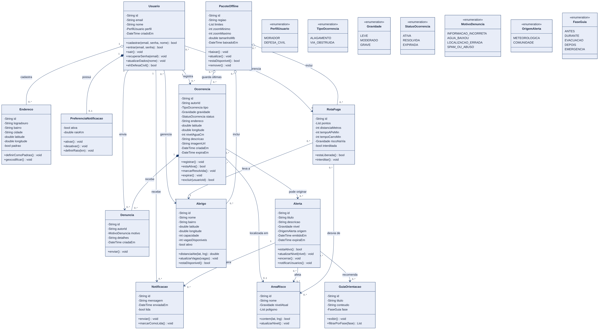
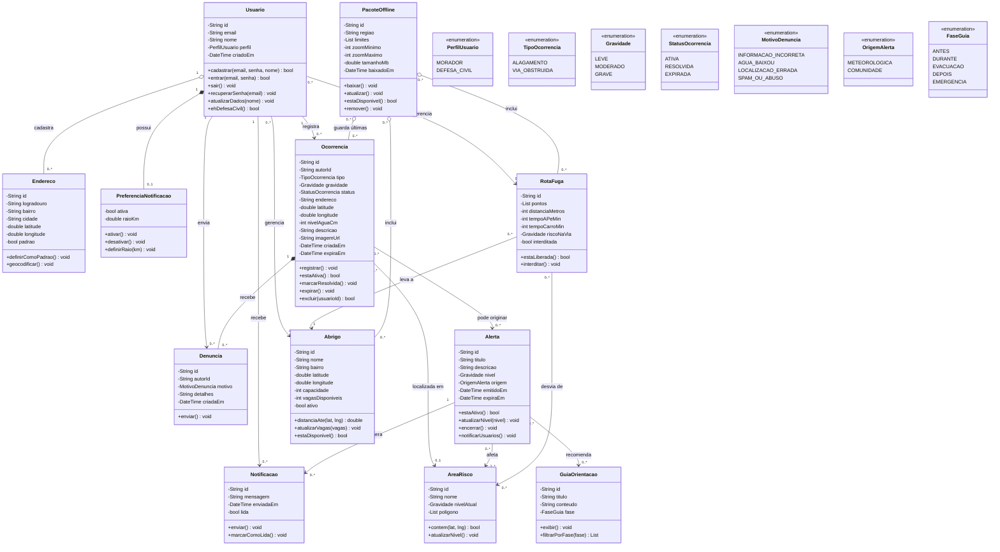

# Diagrama de classes (modelo de domínio) — EnchenteAlerta

Versão da Unidade II. Substitui o diagrama da Unidade I (`docs/diagrama_de_classes`), ajustado aos requisitos, aos CRUDs, ao protótipo de alta fidelidade e ao diagrama de casos de uso atualizado.

> Fonte editável: [`diagrama-de-classes.mmd`](diagrama-de-classes.mmd). O código Mermaid abaixo é renderizado pelo próprio GitHub.

## O que entrou

| Classe / enumeração | Por quê |
|---|---|
| `Ocorrencia` | Registro feito pela comunidade (alagamento ou via obstruída). Sustenta RF02, RF03, RF09 e o CRUD de Ocorrência. |
| `TipoOcorrencia` | Diferencia alagamento de via obstruída, como o grupo definiu para o app. |
| `Denuncia` | Tela "Reportar aviso", com os 4 motivos do protótipo. |
| `Abrigo` e `RotaFuga` | RF04, RF05 e o CRUD de Rota / Abrigo, gerenciados pela Defesa Civil. |
| `PacoteOffline` | RF07 e RNF05: região do mapa baixada em cache, com abrigos, rotas e últimas ocorrências, para uso sem internet. |
| `PerfilUsuario` | Diferencia morador de Defesa Civil, para o controle de acesso. |
| `Gravidade`, `StatusOcorrencia`, `MotivoDenuncia`, `OrigemAlerta`, `FaseGuia` | Substituem textos soltos por valores fixos. |

## O que mudou ou saiu

| Item | Mudança |
|---|---|
| `NivelAlerta` | Virou `Gravidade`, com os 3 níveis do protótipo: Leve, Moderado e Grave. |
| `EstacaoMonitoramento` | Saiu, pois não está nos requisitos. O campo `Alerta.origem` registra se o alerta veio de dado meteorológico ou da comunidade. |
| `Mapa` | Saiu, por ser uma tela e não uma entidade de domínio. |
| `OcorrenciaHistorica` | Saiu. O histórico é uma consulta das ocorrências resolvidas ou expiradas. |
| `GuiaOrientacao.fase` | Passou de texto para enumeração, incluindo a fase Depois. |

## Regras representadas

- **Visitante não tem classe.** Quem usa o app sem conta só consulta dados; não há nada salvo sobre ele. `Usuario` existe apenas para quem cria conta.
- **Anonimato (RNF07).** `Ocorrencia.autorId` e `Denuncia.autorId` ficam salvos só para permitir que o autor exclua o próprio registro e para controle de abuso; nunca aparecem na tela.
- **Controle de acesso.** As associações `gerencia` com `Abrigo` e `RotaFuga` valem apenas para usuários com `perfil = DEFESA_CIVIL` (`ehDefesaCivil()`).
- **Offline.** `PacoteOffline` existe só no celular (cache local), sem coleção no Firestore.

## Pontos em aberto

- O aditivo de regras de negócio da Unidade II pode exigir ajustes neste modelo.
- `PreferenciaNotificacao.raioKm` veio do diagrama original e não aparece nos requisitos.
- `Usuario.nome` aparece no Perfil, mas não na tela de Cadastro do protótipo.
