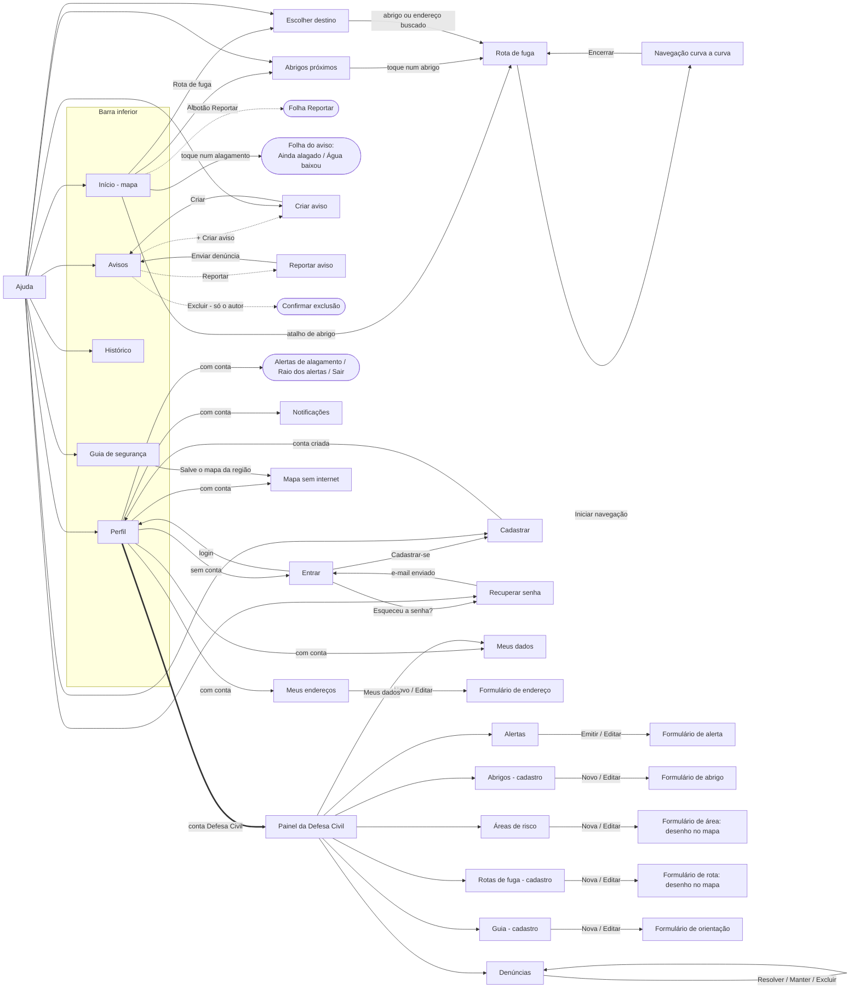

# Fluxo de navegação

Fluxo **real** do app, levantado do código em `lib/screens/` em 17/11/2026 e atualizado em 22/11/2026 (não do protótipo). Telas e nomes seguem o [protótipo de alta fidelidade](prototipoAltaFidelidade.pdf.pdf).

## Como a navegação funciona

- **Barra inferior com 5 abas**, sempre visível: Início, Avisos, Histórico, Perfil e Guia (`lib/screens/tela_principal.dart`). As abas ficam vivas ao trocar (o mapa não recarrega).
- **Telas abertas por cima** (Rota de fuga, Abrigos, Criar aviso etc.) mantêm a barra inferior. Tocar numa aba fecha as telas abertas e vai direto para ela (`irParaAba` em `lib/navegacao.dart`).
- **Botão "i"** no topo das telas mostra a ajuda própria daquela tela, com o atalho "Ver ajuda completa" para a tela Ajuda (um índice com atalho para cada tela). No Início, o "i" abre direto a tela Ajuda.
- **Sem internet**, uma faixa laranja "Sem internet" aparece no rodapé de todas as telas (`lib/widgets/faixa_sem_internet.dart`).
- **Visitante** (sem conta) navega por tudo. Ao tocar numa ação que grava dados (Reportar, Criar aviso, Ainda alagado, Água baixou), aparece o aviso "Entre na sua conta..." com o botão **Entrar**, que leva à aba Perfil.

## Diagrama

Retângulos são telas; retângulos arredondados são folhas e janelas que abrem por cima da tela. Linhas tracejadas pedem conta (sem login, levam ao Entrar). Linhas grossas são só da conta da Defesa Civil.

O botão "i" leva à Ajuda a partir de todas as telas (as ligações não aparecem no diagrama para não poluir).

## Transições

| De | Ação | Para | Precisa de conta |
|---|---|---|---|
| Qualquer tela | Aba da barra inferior | Aba escolhida (fecha as telas abertas por cima) | Não |
| Início | Botão "i" | Ajuda | Não |
| Outras telas | Botão "i" → "Ver ajuda completa" | Janela com a ajuda da tela → Ajuda | Não |
| Início | Botão lua/sol | Alterna entre modo claro e escuro (vale para todas as telas) | Não |
| Início | Atalho de um dos 3 abrigos mais próximos (barra azul sobre o mapa) | Rota de fuga até o abrigo | Não |
| Início | Abrigo | Abrigos próximos | Não |
| Início | Rota de fuga | Escolher destino | Não |
| Início | Botão Reportar (megafone) | Folha Reportar: tipo, gravidade, nível da água | Sim |
| Início | Toque num alagamento do mapa | Folha do aviso: Ainda alagado / Água baixou | Sim, para responder |
| Abrigos próximos | Toque num abrigo | Rota de fuga até o abrigo | Não |
| Escolher destino | Toque num abrigo ou endereço buscado | Rota de fuga | Não |
| Rota de fuga | Iniciar navegação | Navegação curva a curva | Não |
| Navegação | Encerrar | Volta para a Rota de fuga | Não |
| Avisos | + Criar aviso | Criar aviso; ao criar, volta para Avisos | Sim |
| Avisos | Reportar | Reportar aviso; ao enviar, volta para Avisos | Sim |
| Avisos | Excluir (só nos próprios avisos) | Janela de confirmação | Sim |
| Perfil (sem conta) | — | Mostra a tela Entrar | — |
| Entrar | Cadastrar-se | Cadastrar; ao criar a conta, volta para o Perfil | Não |
| Entrar | Esqueceu a senha? | Recuperar senha; ao enviar o e-mail, volta para Entrar | Não |
| Perfil (com conta) | Meus dados | Tela Meus dados: nome, e-mail, tipo de conta e Alterar senha | Sim |
| Perfil (com conta) | Alertas de alagamento | Interruptor na própria tela (liga ou desliga a faixa de alertas do Início) | Sim |
| Perfil (com conta) | Notificações | Alertas recebidos: tocar abre o alerta e marca como lida; Excluir; Marcar todas como lidas | Sim |
| Perfil (com conta) | Raio dos alertas | Janela com 1, 2, 5, 10 ou 20 km | Sim |
| Perfil (com conta) | Endereço padrão | Meus endereços; Novo endereço / Editar abrem o formulário; menu com Usar como padrão e Excluir | Sim |
| Perfil (com conta) ou Guia | Mapa sem internet / Salve o mapa da região | Tela Mapa sem internet: Salvar mapa da região e Apagar | Não (no Guia) |
| Perfil (com conta) | Sair | Janela de confirmação; volta para a tela Entrar | Sim |
| Perfil (conta Defesa Civil) | — | A aba aparece como "Painel" e mostra o Painel da Defesa Civil | Defesa Civil |
| Painel | Denúncias | Avisos denunciados: Resolver, Manter ou Excluir (cada um com confirmação) | Defesa Civil |
| Painel | Alertas | Lista de alertas; Emitir alerta / Editar abrem o formulário; Encerrar e Excluir pedem confirmação | Defesa Civil |
| Painel | Abrigos | Lista de abrigos com − e + nas vagas; Novo abrigo / Editar abrem o formulário | Defesa Civil |
| Painel | Áreas de risco | Lista; Nova / Editar abrem o formulário com o desenho da área no mapa | Defesa Civil |
| Painel | Rotas de fuga | Lista com interruptor Liberada/Interditada; Nova / Editar abrem o formulário com o desenho do caminho até o abrigo | Defesa Civil |
| Painel | Guia de segurança | Lista por seção; Nova orientação / toque editam; "Publicar o guia de exemplo" quando vazio | Defesa Civil |
| Avisos (conta Defesa Civil) | Resolver | Janela de confirmação; o aviso sai do mapa | Defesa Civil |
| Início ou Avisos | Faixa de alerta da Defesa Civil | Folha com todos os alertas ativos | Não |
| Ajuda | Item da lista | Tela correspondente (aba ou tela aberta por cima) | Criar avisos: sim |

## Pontos a ajustar (encontrados no levantamento)

1. ~~**"?" nas telas de conta** abria uma janela de texto, e não a tela Ajuda.~~ Resolvido em 18/11/2026: todas as telas usam o mesmo botão "i" (`BotaoAjuda` em `lib/widgets/ajuda.dart`).
2. ~~**Endereço padrão** (Perfil) ainda mostrava "em breve".~~ Resolvido em 22/11/2026: tela Meus endereços.
3. ~~**Atalhos do Início** não faziam nada ao tocar.~~ Resolvido em 23/11/2026: mostram os 3 abrigos mais próximos e abrem a rota até eles.
