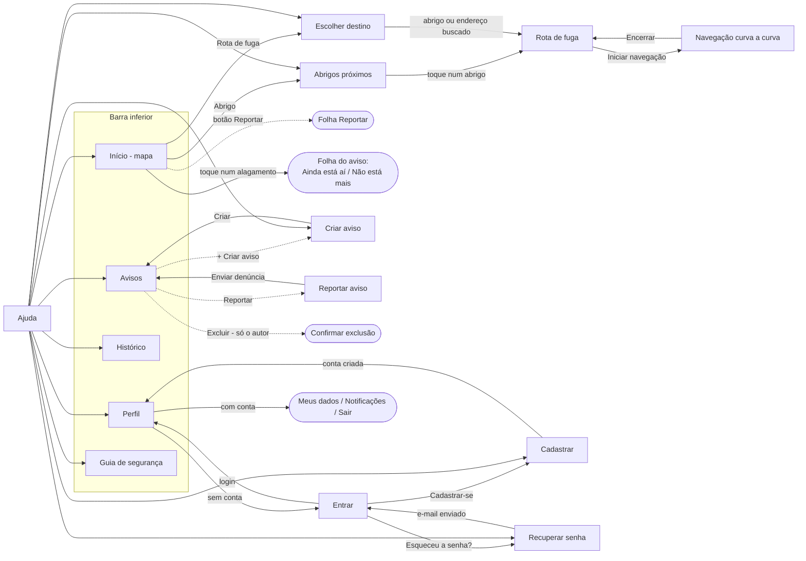

# Fluxo de navegação

Fluxo **real** do app, levantado do código em `lib/screens/` em 17/11/2026 (não do protótipo). Telas e nomes seguem o [protótipo de alta fidelidade](prototipoAltaFidelidade.pdf.pdf).

## Como a navegação funciona

- **Barra inferior com 5 abas**, sempre visível: Início, Avisos, Histórico, Perfil e Guia (`lib/screens/tela_principal.dart`). As abas ficam vivas ao trocar (o mapa não recarrega).
- **Telas abertas por cima** (Rota de fuga, Abrigos, Criar aviso etc.) mantêm a barra inferior. Tocar numa aba fecha as telas abertas e vai direto para ela (`irParaAba` em `lib/navegacao.dart`).
- **Botão "?"** no topo das telas abre a tela Ajuda, que é um índice com atalho para cada tela.
- **Visitante** (sem conta) navega por tudo. Ao tocar numa ação que grava dados (Reportar, Criar aviso, Ainda está aí, Não está mais), aparece o aviso "Entre na sua conta..." com o botão **Entrar**, que leva à aba Perfil.

## Diagrama

Retângulos são telas; retângulos arredondados são folhas e janelas que abrem por cima da tela. Linhas tracejadas pedem conta (sem login, levam ao Entrar).

O botão "?" abre a Ajuda a partir de quase todas as telas (as ligações não aparecem no diagrama para não poluir).

## Transições

| De | Ação | Para | Precisa de conta |
|---|---|---|---|
| Qualquer tela | Aba da barra inferior | Aba escolhida (fecha as telas abertas por cima) | Não |
| Qualquer tela com "?" | Botão "?" | Ajuda | Não |
| Início | Abrigo | Abrigos próximos | Não |
| Início | Rota de fuga | Escolher destino | Não |
| Início | Botão Reportar (megafone) | Folha Reportar: tipo, gravidade, nível da água | Sim |
| Início | Toque num alagamento do mapa | Folha do aviso: Ainda está aí / Não está mais | Sim, para responder |
| Abrigos próximos | Toque num abrigo | Rota de fuga até o abrigo | Não |
| Escolher destino | Toque num abrigo ou endereço buscado | Rota de fuga | Não |
| Rota de fuga | Iniciar navegação | Navegação curva a curva | Não |
| Navegação | Encerrar | Volta para a Rota de fuga | Não |
| Avisos | + Criar aviso | Criar aviso; ao criar, volta para Avisos | Sim |
| Avisos | Reportar | Reportar aviso; ao enviar, volta para Avisos | Sim |
| Avisos | Excluir (só nos próprios avisos) | Janela de confirmação | Sim |
| Perfil (sem conta) | — | Mostra a tela Entrar | — |
| Entrar | Cadastrar-se | Cadastrar; ao criar a conta, volta para o Perfil | Não |
| Entrar | Esqueceu a senha? | Recuperar senha; ao enviar o e-mail, volta para Entrar | Não |
| Perfil (com conta) | Meus dados / Notificações / Sair | Janelas de edição e confirmação | Sim |
| Ajuda | Item da lista | Tela correspondente (aba ou tela aberta por cima) | Criar avisos: sim |

## Pontos a ajustar (encontrados no levantamento)

1. **"?" nas telas de conta:** em Entrar, Cadastrar, Recuperar senha e Perfil, o botão "?" abre uma janela de texto, e não a tela Ajuda como nas outras telas (`barraConta` em `lib/widgets/widgets_conta.dart`).
2. **Endereço padrão** (Perfil) ainda mostra "em breve" (previsto para a Sprint 2).
3. **Atalhos do Início** (Hosp. Universitário, Escola Exemplo, Farolândia) aparecem no topo do mapa, mas não fazem nada ao tocar. No protótipo eles indicam locais próximos; podem abrir a rota até o local.
