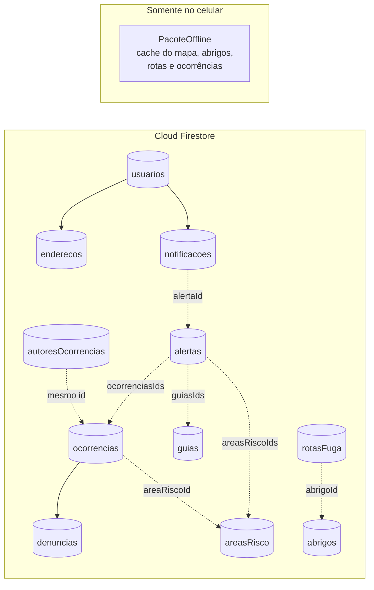

# Modelagem do Banco de Dados (Firestore) — EnchenteAlerta

Este documento mostra a estrutura de coleções e documentos no Cloud Firestore e como cada classe de domínio do Dart (ver [`diagrama-de-classes.md`](diagrama-de-classes.md)) é mapeada para essa estrutura.

## 1. Visão geral das coleções



```text
usuarios/{uid}
  ├── enderecos/{enderecoId}
  └── notificacoes/{notificacaoId}
ocorrencias/{ocorrenciaId}
  └── denuncias/{denunciaId}
autoresOcorrencias/{ocorrenciaId}
alertas/{alertaId}
areasRisco/{areaRiscoId}
abrigos/{abrigoId}
rotasFuga/{rotaId}
guias/{guiaId}
```

## 2. Decisões de modelagem

| Decisão | Motivo |
|---|---|
| O id do documento em `usuarios` é o `uid` do Firebase Auth. | Liga o login ao perfil sem consulta extra e simplifica as regras de segurança. |
| `PreferenciaNotificacao` fica **dentro** do documento do usuário (campo `preferenciaNotificacao`). | É composição 1 para 0..1 no diagrama de classes: só existe junto do usuário. |
| `Endereco` e `Notificacao` são **subcoleções** do usuário. | Pertencem a um único usuário e podem ser muitos. |
| `Denuncia` é **subcoleção** da ocorrência. | Composição no diagrama: a denúncia não existe sem a ocorrência. |
| O autor da ocorrência fica em **`autoresOcorrencias`**, separado da ocorrência. | O Firestore não esconde campos: quem lê um documento lê todos. Separando o autor, a ocorrência pode ser pública sem expor quem registrou (RNF07). |
| Latitude e longitude viram um **`GeoPoint`**. | Tipo nativo do Firestore para coordenadas. |
| Datas viram **`Timestamp`**. | Tipo nativo; permite ordenar e filtrar por data (histórico, expiração). |
| Enumerações são gravadas como **texto** (campo `codigo` de cada valor, ex.: `Gravidade.grave` grava `"GRAVE"`). | Fica legível no console do Firebase e não quebra se a ordem do enum mudar. |
| Relações muitos-para-muitos viram **listas de ids** (ex.: `areasRiscoIds`). | O Firestore não tem junção (join); listas de ids são o padrão. |
| `PacoteOffline` **não** vai para o Firestore. | É o cache local do celular (mapa baixado, abrigos, rotas e últimas ocorrências). O próprio Firestore também mantém cache local dos documentos lidos. |
| Visitante não tem documento. | Quem usa sem conta só lê dados públicos; nada é salvo sobre ele. |

## 3. Estrutura de cada coleção

### `usuarios/{uid}` — classe `Usuario`

| Campo | Tipo Firestore | Atributo Dart |
|---|---|---|
| `email` | string | `String email` |
| `nome` | string | `String nome` |
| `perfil` | string (`MORADOR` \| `DEFESA_CIVIL`) | `PerfilUsuario perfil` |
| `criadoEm` | timestamp | `DateTime criadoEm` |
| `preferenciaNotificacao` | map `{ ativa: bool, raioKm: number }` | `PreferenciaNotificacao?` |

Subcoleção `enderecos/{enderecoId}` — classe `Endereco`: `logradouro`, `bairro`, `cidade` (string), `localizacao` (geopoint), `padrao` (bool).

Subcoleção `notificacoes/{notificacaoId}` — classe `Notificacao`: `mensagem` (string), `alertaId` (string), `enviadaEm` (timestamp), `lida` (bool).

### `ocorrencias/{ocorrenciaId}` — classe `Ocorrencia`

| Campo | Tipo Firestore | Atributo Dart |
|---|---|---|
| `tipo` | string (`ALAGAMENTO` \| `VIA_OBSTRUIDA`) | `TipoOcorrencia tipo` |
| `gravidade` | string (`LEVE` \| `MODERADO` \| `GRAVE`) | `Gravidade gravidade` |
| `status` | string (`ATIVA` \| `RESOLVIDA` \| `EXPIRADA`) | `StatusOcorrencia status` |
| `endereco` | string | `String endereco` |
| `localizacao` | geopoint | `double latitude`, `double longitude` |
| `nivelAguaCm` | number | `int nivelAguaCm` |
| `descricao` | string (opcional) | `String? descricao` |
| `imagemUrl` | string (opcional) | `String? imagemUrl` |
| `areaRiscoId` | string (opcional) | relação `localizada em` |
| `criadaEm` | timestamp | `DateTime criadaEm` |
| `expiraEm` | timestamp | `DateTime expiraEm` |

Subcoleção `denuncias/{denunciaId}` — classe `Denuncia`: `autorId` (string), `motivo` (string: `INFORMACAO_INCORRETA` \| `AGUA_BAIXOU` \| `LOCALIZACAO_ERRADA` \| `SPAM_OU_ABUSO`), `detalhes` (string), `criadaEm` (timestamp).

### `autoresOcorrencias/{ocorrenciaId}` — atributo `Ocorrencia.autorId`

| Campo | Tipo Firestore | Observação |
|---|---|---|
| `autorId` | string (uid) | Mesmo id do documento da ocorrência. Só o próprio autor e a Defesa Civil leem. |

### `alertas/{alertaId}` — classe `Alerta`

| Campo | Tipo Firestore | Atributo Dart |
|---|---|---|
| `titulo` | string | `String titulo` |
| `descricao` | string | `String descricao` |
| `nivel` | string (`LEVE` \| `MODERADO` \| `GRAVE`) | `Gravidade nivel` |
| `origem` | string (`METEOROLOGICA` \| `COMUNIDADE`) | `OrigemAlerta origem` |
| `areasRiscoIds` | array de string | relação `afeta` |
| `ocorrenciasIds` | array de string | relação `pode originar` |
| `guiasIds` | array de string | relação `recomenda` |
| `emitidoEm` | timestamp | `DateTime emitidoEm` |
| `expiraEm` | timestamp | `DateTime expiraEm` |

### `areasRisco/{areaRiscoId}` — classe `AreaRisco`

`nome` (string), `nivelAtual` (string, `Gravidade`), `poligono` (array de geopoint).

### `abrigos/{abrigoId}` — classe `Abrigo`

| Campo | Tipo Firestore | Atributo Dart |
|---|---|---|
| `nome` | string | `String nome` |
| `bairro` | string | `String bairro` |
| `localizacao` | geopoint | `double latitude`, `double longitude` |
| `capacidade` | number | `int capacidade` |
| `vagasDisponiveis` | number | `int vagasDisponiveis` |
| `ativo` | boolean | `bool ativo` |
| `atualizadoPor` | string (uid) | relação `gerencia` (Defesa Civil) |
| `atualizadoEm` | timestamp | controle de alteração |

### `rotasFuga/{rotaId}` — classe `RotaFuga`

| Campo | Tipo Firestore | Atributo Dart |
|---|---|---|
| `abrigoId` | string | relação `leva a` |
| `pontos` | array de geopoint | `List pontos` |
| `distanciaMetros` | number | `int distanciaMetros` |
| `tempoAPeMin` | number | `int tempoAPeMin` |
| `tempoCarroMin` | number | `int tempoCarroMin` |
| `riscoNaVia` | string (`Gravidade`) | `Gravidade riscoNaVia` |
| `interditada` | boolean | `bool interditada` |
| `areasEvitadasIds` | array de string | relação `desvia de` |
| `atualizadoPor` | string (uid) | relação `gerencia` (Defesa Civil) |

### `guias/{guiaId}` — classe `GuiaOrientacao`

`titulo` (string), `conteudo` (string), `fase` (string: `ANTES` \| `DURANTE` \| `EVACUACAO` \| `DEPOIS` \| `EMERGENCIA`), `ordem` (number, para a ordem de exibição).

## 4. Como as classes Dart se mapeiam para o Firestore

Cada classe de domínio tem um construtor `fromFirestore`, que monta o objeto a partir do documento, e um método `toFirestore`, que gera o mapa de campos a gravar. O id do documento não é gravado como campo: ele vem de `doc.id`.

Código completo em [`lib/models/`](../lib/models/) (uma classe por arquivo, todas exportadas por `models.dart`). Detalhes da implementação:

- As enumerações seguem o padrão do Dart (`Gravidade.grave`), e cada valor guarda o `codigo` gravado no Firestore (`"GRAVE"`) e o `rotulo` mostrado na tela (`"Grave"`). A leitura usa `enumPorCodigo`, que dá erro se o texto do banco for inválido.
- Coordenadas usam `LatLng` (pacote `latlong2`, o mesmo do mapa) e viram `GeoPoint` no Firestore.
- Cada classe tem `fromFirestore(doc)`, que chama `fromMap(id, dados)`. O `fromMap` permite testar o mapeamento sem conexão (`test/models_test.dart`).
- Os métodos do diagrama que dependem do Firebase (cadastrar, entrar, registrar, excluir) ficam nos serviços, não nas classes.

Exemplo resumido com `Ocorrencia` (`lib/models/ocorrencia.dart`):

```dart
enum Gravidade implements EnumFirestore {
  leve('LEVE', 'Leve'),
  moderado('MODERADO', 'Moderado'),
  grave('GRAVE', 'Grave');

  const Gravidade(this.codigo, this.rotulo);
  @override
  final String codigo;
  @override
  final String rotulo;
}

class Ocorrencia {
  final String id;
  final TipoOcorrencia tipo;
  final Gravidade gravidade;
  final StatusOcorrencia status;
  final String endereco;
  final LatLng localizacao;
  final int nivelAguaCm;
  final String? descricao;
  final DateTime criadaEm;
  final DateTime expiraEm;
  // ... construtor, imagemUrl e areaRiscoId

  // Documento do Firestore -> objeto Dart
  factory Ocorrencia.fromFirestore(DocumentSnapshot<Map<String, dynamic>> doc) =>
      Ocorrencia.fromMap(doc.id, doc.data()!);

  factory Ocorrencia.fromMap(String id, Map<String, dynamic> d) => Ocorrencia(
        id: id,
        tipo: enumPorCodigo(TipoOcorrencia.values, d['tipo']),
        gravidade: enumPorCodigo(Gravidade.values, d['gravidade']),
        status: enumPorCodigo(StatusOcorrencia.values, d['status']),
        endereco: d['endereco'] as String,
        localizacao: lerPonto(d['localizacao']),   // GeoPoint -> LatLng
        nivelAguaCm: lerInt(d['nivelAguaCm']),
        descricao: d['descricao'] as String?,
        criadaEm: lerData(d['criadaEm']),          // Timestamp -> DateTime
        expiraEm: lerData(d['expiraEm']),
      );

  // Objeto Dart -> campos gravados no Firestore
  Map<String, dynamic> toFirestore() => {
        'tipo': tipo.codigo,
        'gravidade': gravidade.codigo,
        'status': status.codigo,
        'endereco': endereco,
        'localizacao': gravarPonto(localizacao),   // LatLng -> GeoPoint
        'nivelAguaCm': nivelAguaCm,
        if (descricao != null) 'descricao': descricao,
        'criadaEm': Timestamp.fromDate(criadaEm),
        'expiraEm': Timestamp.fromDate(expiraEm),
      };
}
```

Uso com o conversor tipado do Firestore:

```dart
final ocorrenciasRef = FirebaseFirestore.instance
    .collection('ocorrencias')
    .withConverter<Ocorrencia>(
      fromFirestore: (snap, _) => Ocorrencia.fromFirestore(snap),
      toFirestore: (ocorrencia, _) => ocorrencia.toFirestore(),
    );

// Ocorrências ativas, atualizadas em tempo real no mapa (RF09)
final ativas = ocorrenciasRef
    .where('status', isEqualTo: StatusOcorrencia.ativa.codigo)
    .snapshots();
```

Registro de uma ocorrência gravando o autor separado, numa única operação:

```dart
final db = FirebaseFirestore.instance;
final novaRef = db.collection('ocorrencias').doc();
final lote = db.batch();
lote.set(novaRef, ocorrencia.toFirestore());
lote.set(db.collection('autoresOcorrencias').doc(novaRef.id), {
  'autorId': FirebaseAuth.instance.currentUser!.uid,
});
await lote.commit();
```

### Resumo do mapeamento de tipos

| Dart | Firestore |
|---|---|
| `String` | string |
| `int`, `double` | number |
| `bool` | boolean |
| `DateTime` | timestamp (`Timestamp.fromDate` / `.toDate()`) |
| `LatLng` (latitude + longitude) | geopoint (`GeoPoint`) |
| `enum` | string (`.codigo` / `enumPorCodigo`) |
| `List` de pontos | array de geopoint |
| composição 1 para 0..1 | map dentro do documento |
| composição 1 para muitos | subcoleção |
| associação | campo com o id (ou lista de ids) |

## 5. Regras de segurança (controle de acesso)

Resumo de quem pode ler e gravar em cada coleção. O arquivo `firestore.rules` do projeto deve seguir esta tabela.

| Coleção | Leitura | Criação | Alteração / exclusão |
|---|---|---|---|
| `usuarios/{uid}` e subcoleções | o próprio usuário | o próprio usuário | o próprio usuário (não pode mudar o próprio `perfil`) |
| `ocorrencias` | qualquer pessoa, inclusive Visitante | usuário logado | autor (excluir) e Defesa Civil |
| `ocorrencias/{id}/denuncias` | Defesa Civil | usuário logado | Defesa Civil |
| `autoresOcorrencias` | o próprio autor e Defesa Civil | usuário logado, com o próprio uid | ninguém |
| `alertas`, `areasRisco`, `guias` | qualquer pessoa | Defesa Civil | Defesa Civil |
| `abrigos`, `rotasFuga` | qualquer pessoa | Defesa Civil | Defesa Civil |

Esboço das regras:

```js
rules_version = '2';
service cloud.firestore {
  match /databases/{database}/documents {

    function logado() { return request.auth != null; }
    function ehDefesaCivil() {
      return logado() &&
        get(/databases/$(database)/documents/usuarios/$(request.auth.uid)).data.perfil == 'DEFESA_CIVIL';
    }
    function ehAutor(ocorrenciaId) {
      return logado() &&
        get(/databases/$(database)/documents/autoresOcorrencias/$(ocorrenciaId)).data.autorId == request.auth.uid;
    }

    match /usuarios/{uid} {
      allow read: if logado() && request.auth.uid == uid;
      allow create: if logado() && request.auth.uid == uid && request.resource.data.perfil == 'MORADOR';
      allow update: if logado() && request.auth.uid == uid && request.resource.data.perfil == resource.data.perfil;
      match /{sub=**} {
        allow read, write: if logado() && request.auth.uid == uid;
      }
    }

    match /ocorrencias/{id} {
      allow read: if true;
      allow create: if logado();
      allow update: if ehDefesaCivil();
      allow delete: if ehAutor(id) || ehDefesaCivil();
      match /denuncias/{denunciaId} {
        allow read, update, delete: if ehDefesaCivil();
        allow create: if logado() && request.resource.data.autorId == request.auth.uid;
      }
    }

    match /autoresOcorrencias/{id} {
      allow read: if logado() && (resource.data.autorId == request.auth.uid || ehDefesaCivil());
      allow create: if logado() && request.resource.data.autorId == request.auth.uid;
    }

    match /{colecao}/{id} {
      allow read: if colecao in ['alertas', 'areasRisco', 'guias', 'abrigos', 'rotasFuga'];
      allow write: if colecao in ['alertas', 'areasRisco', 'guias', 'abrigos', 'rotasFuga'] && ehDefesaCivil();
    }
  }
}
```

O perfil `DEFESA_CIVIL` é definido manualmente no console do Firebase; pelo app, toda conta nova é criada como `MORADOR`.

## 6. Pontos em aberto

- O aditivo de regras de negócio da Unidade II pode acrescentar campos ou regras de acesso.
- `imagemUrl` está mantido como campo opcional; guardar a foto em si depende de uma solução de armazenamento sem custo.
- Busca de ocorrências por proximidade: com poucos registros, o app carrega as ativas e filtra a distância no celular. Se o volume crescer, será preciso indexar por geohash.
- Expiração automática de ocorrências: sem Cloud Functions (plano pago), o app trata como expirada a ocorrência com `expiraEm` no passado, e a Defesa Civil pode marcá-la como `EXPIRADA`.
