# Planejamento do projeto — Unidade II

Escopo, EAP simplificada e planejamento em sprints do **EnchenteAlerta**. Os requisitos citados (RF, RNF) estão em [`requisitos.md`](requisitos.md).

## 1. Escopo

### Objetivo

Entregar um app Android em Flutter, com Firebase Authentication e Cloud Firestore, que ajude moradores de áreas de risco a se prevenir e agir durante enchentes. O app tem mapa de alagamentos informados pela comunidade, rotas de fuga que desviam deles, abrigos, guia de segurança e controle de acesso por perfil.

### Perfis de acesso

| Perfil | O que pode fazer |
|---|---|
| Visitante (sem conta) | Consultar mapa, avisos, rotas, abrigos, histórico e guia |
| Morador (conta nova) | Tudo do Visitante, mais criar avisos, confirmar, denunciar, excluir os próprios avisos e configurar alertas |
| Defesa Civil (definido no console do Firebase) | Tudo do Morador, mais gerenciar abrigos, rotas, alertas e áreas de risco, revisar denúncias e resolver avisos |

### Dentro do escopo

| Entrega | Requisitos | Situação em 17/11 |
|---|---|---|
| Mapa com os pontos de alagamento em tempo real | RF02, RF09 | Pronto |
| Criar aviso de alagamento de forma anônima, confirmar ("Ainda está aí"), denunciar e excluir o próprio aviso | RF03, RNF07 | Pronto |
| Rotas de fuga reais que desviam dos alagamentos confirmados, com navegação curva a curva | RF04 | Pronto |
| Abrigos próximos, ordenados pela distância | RF05 | Pronto (dados de exemplo) |
| Guia de segurança (antes, durante, evacuação e emergência) | RF06 | Pronto (dados de exemplo) |
| Histórico de alagamentos | Funcionalidade 7 | Pronto (lê do Firestore) |
| Entrar, cadastrar, recuperar senha e perfil | RNF06 | Pronto |
| Regras de segurança do Firestore: perfis, anonimato e validação dos dados | RNF06, RNF07 | Pronto |
| Modo noturno, alto contraste e textos maiores | RNF02, RNF03, RNF10 | Pronto |
| Telas da Defesa Civil: alertas, abrigos e revisão de denúncias | RF01, CRUD de Alerta e Abrigo | Pronto em 22/11 (rotas cadastradas pela Defesa Civil: Sprint 3) |
| Alertas dentro do app, por localização, com opção de desativar | RF01, RF08 | Faixa de alertas e opção de desativar prontas em 22/11; filtro por localização: Sprint 3 |
| Histórico, abrigos e guia lendo do Firestore | RF09 | Sprints 2 e 3 |
| Mapa da região guardado para uso sem internet e aviso de falta de conexão | RF07, RNF05 | Sprint 2 |
| Perfil: Meus dados, Notificações e Endereço padrão | CRUD de Preferências | Sprint 2 |

### Fora do escopo (nesta entrega)

| Item | Motivo |
|---|---|
| Notificação push com o app fechado | Exige Cloud Functions, que só existem no plano pago do Firebase. Os alertas aparecem com o app aberto. |
| Foto da ocorrência | Exige Firebase Storage, que pede o plano pago em projetos novos. Fica como melhoria futura. |
| Versão para iOS | O grupo testa só no Android (emulador e aparelhos). |
| Alertas automáticos a partir de dados meteorológicos | Precisa de um serviço externo e de um servidor; os alertas são emitidos pela Defesa Civil no app. |

### Restrições

- Stack obrigatória: Dart, Flutter e Firebase (Authentication e Firestore).
- Sem custos: plano Spark do Firebase e chave gratuita do OpenRouteService.
- Apresentações em 24/11/2026 e 01/12/2026; o app precisa compilar e rodar no emulador.

## 2. EAP simplificada

Estrutura Analítica do Projeto: o trabalho dividido em pacotes de entrega.

```mermaid
flowchart TD
    P[EnchenteAlerta] --> D[1. Documentação]
    P --> I[2. Infraestrutura]
    P --> T[3. Telas do app]
    P --> C[4. Defesa Civil]
    P --> O[5. Uso offline]
    P --> Q[6. Testes e entrega]

    D --> D1[1.1 Requisitos e protótipos]
    D --> D2[1.2 Casos de uso e classes]
    D --> D3[1.3 Modelagem do Firestore]
    D --> D4[1.4 Planejamento, fluxo de navegação e uso de IA]

    I --> I1[2.1 Projeto Flutter e Firebase]
    I --> I2[2.2 Tema e navegação]
    I --> I3[2.3 Classes de domínio]
    I --> I4[2.4 Regras de segurança]

    T --> T1[3.1 Mapa e rotas: Início, Rota de fuga, Abrigos]
    T --> T2[3.2 Avisos: lista, Criar, Reportar]
    T --> T3[3.3 Conta: Entrar, Cadastrar, Recuperar senha, Perfil]
    T --> T4[3.4 Apoio: Histórico, Guia, Ajuda]

    C --> C1[4.1 Emitir alertas]
    C --> C2[4.2 Gerenciar abrigos e rotas]
    C --> C3[4.3 Revisar denúncias e resolver avisos]

    O --> O1[5.1 Mapa da região em cache]
    O --> O2[5.2 Aviso de falta de conexão]

    Q --> Q1[6.1 Testes automatizados]
    Q --> Q2[6.2 Teste no emulador]
    Q --> Q3[6.3 Apresentação]
```

| Pacote | Responsável |
|---|---|
| 1. Documentação | Todos; consolidação: Vinicius |
| 2. Infraestrutura | Vinicius (navegação: Pedro) |
| 3.1 Mapa e rotas | Pedro |
| 3.2 Avisos | Vinicius |
| 3.3 Conta | Christian |
| 3.4 Apoio | Bernardo |
| 4. Defesa Civil | Vinicius |
| 5. Uso offline | A definir na Sprint 2 |
| 6. Testes e entrega | Todos |

## 3. Planejamento em sprints

Sprints de uma semana. Cada tarefa vira uma branch `feature/` com PR para a `develop`; no fim da sprint, a `develop` estável vai para a `main` ([`CONTRIBUTING.md`](../CONTRIBUTING.md)).

### Sprint 0 — preparação (03 a 09/11) — concluída

| Tarefa | Responsável |
|---|---|
| Diagrama de casos de uso da Unidade II | Pedro; revisão: Vinicius |
| Diagrama de classes | Christian; revisão: Vinicius |
| Modelagem do Firestore | Vinicius |
| Projeto Flutter, projeto Firebase, tema claro/escuro | Vinicius |

### Sprint 1 (10 a 16/11) — concluída, mesclada na `main` em 17/11

| Tarefa | Responsável | PR |
|---|---|---|
| Classes de domínio (`lib/models/`) | Vinicius | #1 |
| Navegação, tela Início, Rota de fuga e Abrigos | Pedro | #3 |
| Entrar, Cadastrar, Recuperar senha e Perfil | Christian | #2 |
| Regras de segurança do Firestore | Vinicius | #5 |
| Rotas reais, GPS, navegação curva a curva, Reportar e confirmações | Pedro | #6 |
| Histórico, Guia de segurança e Ajuda | Bernardo | #7 |
| Correção do cadastro | Vinicius | #8 |
| Avisos, Criar aviso e Reportar aviso | Vinicius | #9 |
| README com as responsabilidades | Vinicius | #11 |

Resultado: as 13 telas do protótipo no app, com Firebase Auth e Firestore.

### Sprint 2 (17 a 23/11) — proposta, a confirmar com o grupo

| Tarefa | Responsável |
|---|---|
| Perfil da Defesa Civil: emitir alertas, gerenciar abrigos, revisar denúncias e resolver avisos — feito em 22/11 | Vinicius |
| Alertas no app por localização, com opção de desativar (RF01, RF08) | Vinicius |
| Histórico lendo do Firestore (avisos resolvidos ou expirados) — feito em 22/11 | Vinicius |
| Mapa da região em cache e aviso de falta de conexão (RF07, RNF05) | Pedro |
| Perfil: Meus dados, Notificações e Endereço padrão | Christian |
| Revisão da documentação (fluxo de navegação feito em 17/11: [`fluxo-navegacao.md`](fluxo-navegacao.md)) | Todos |

Meta: app completo e estável na `main` antes da apresentação de 24/11.

### Sprint 3 (24 a 30/11) — proposta

| Tarefa | Responsável |
|---|---|
| Ajustes pedidos na apresentação de 24/11 | Todos |
| Abrigos e guia lendo do Firestore (cadastrados pela Defesa Civil) | A definir |
| Testes finais no emulador e ensaio da arguição | Todos |

Meta: versão final na `main` para a apresentação de 01/12.
