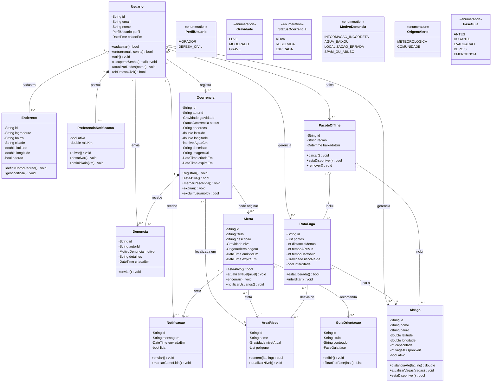

# Rascunho: diagrama de classes corrigido

**Status:** rascunho gerado com IA, para o Christian revisar. Não substitui `docs/diagrama_de_classes` até o grupo aprovar.

## O que entrou

| Item | Por quê |
|------|---------|
| Ocorrencia | Relato da comunidade: sustenta as telas Avisos e Criar aviso, RF02, RF03 e o CRUD de Ocorrência. |
| Denuncia | Tela Reportar aviso, com os 4 motivos do protótipo. |
| Abrigo | RF05, tela Abrigos próximos e CRUD de Rota / Abrigo. |
| RotaFuga | RF04, tela Rota de fuga e CRUD de Rota / Abrigo. |
| PacoteOffline | RF07 e RNF05: mapa, abrigos e rotas baixados para uso sem internet. |
| PerfilUsuario | Diferencia morador de Defesa Civil, para o controle de acesso. |
| Enumerações | StatusOcorrencia, MotivoDenuncia, OrigemAlerta e FaseGuia substituem textos soltos. |

## O que mudou ou saiu

| Mudança | Por quê |
|---------|---------|
| NivelAlerta virou Gravidade | O protótipo usa 3 níveis: Leve, Moderado e Grave. |
| EstacaoMonitoramento saiu | Não está nos requisitos. O campo Alerta.origem registra se o alerta veio de dado meteorológico ou da comunidade. |
| Mapa saiu | É uma tela, e o próprio prompt do grupo pedia para não incluir telas. |
| OcorrenciaHistorica saiu | O Histórico vira uma consulta das ocorrências resolvidas ou expiradas, sem classe separada. |
| GuiaOrientacao.fase | Passou de texto para enumeração, incluindo a fase Depois, que falta no protótipo. |

## A confirmar

- O aditivo de regras de negócio pode mudar este modelo. Ele ainda não foi analisado.
- Ocorrencia.autorId fica guardado só para permitir o botão Excluir ao autor, e nunca pode aparecer na tela (RNF07).
- As rotas estão como dados cadastrados, conforme o CRUD. Se forem calculadas por uma API, RotaFuga passa a ser um resultado do cálculo.
- PacoteOffline existe só no celular, sem coleção no Firestore.
- O protótipo não tem tela para a Defesa Civil gerenciar abrigos e rotas. O grupo precisa decidir como isso será feito.
- Usuario.nome aparece no Perfil, mas não na tela Cadastrar do protótipo.
- PreferenciaNotificacao.raioKm veio do diagrama original e não aparece nos requisitos.
